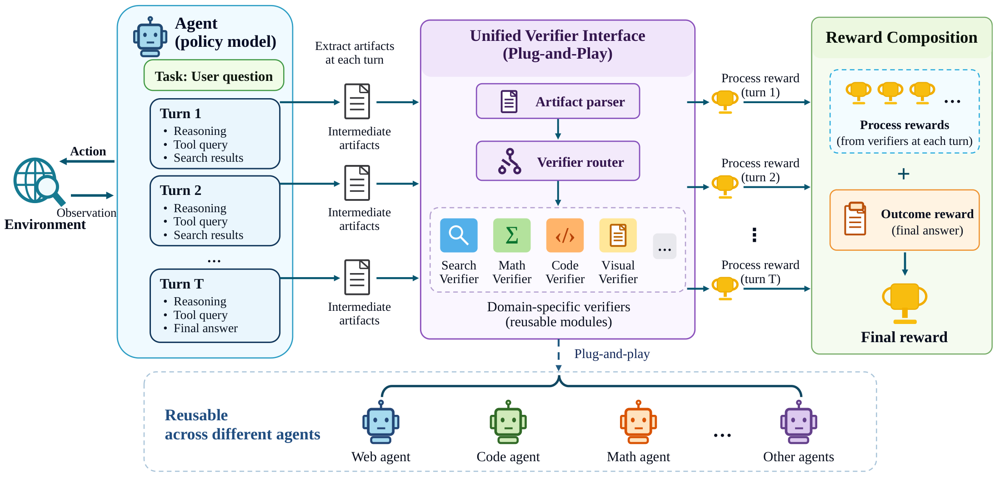
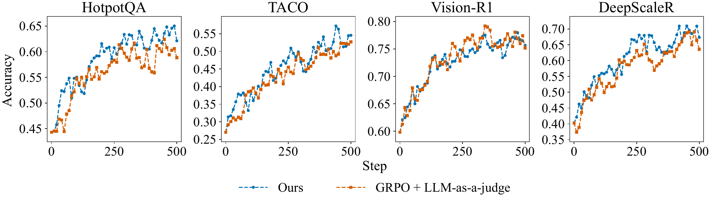
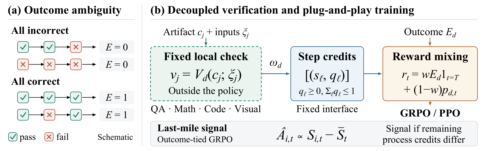
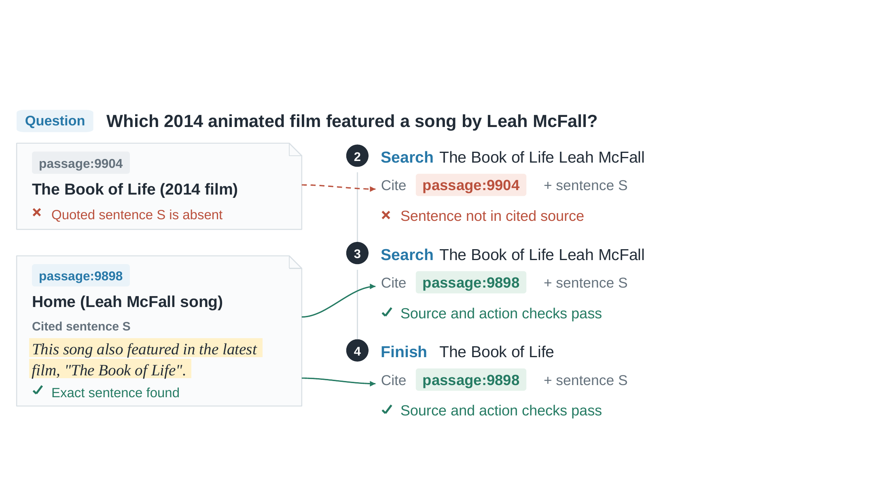

# Plug-and-Play Verifier for Decoupling Process Reward in Stabilizing Long-Horizon Agentic Reasoning

**A plug-and-play verifier framework for stabilizing long-horizon reasoning through explicit verification of intermediate reasoning artifacts.** A shared verification interface connects domain-specific checks to GRPO and PPO across mathematics, multi-hop QA, code, and vision.

[Results](#results) · [Quick Start](#quick-start) · [Method](#method) · [Evaluation](#evaluation) · [Documentation](#documentation)

Built on [Agent-R1](https://github.com/AgentR1/Agent-R1), [veRL](https://github.com/volcengine/verl), and [vLLM](https://github.com/vllm-project/vllm).



*Artifacts from each interaction are checked by domain verifiers. A common interface returns bounded credits and their source steps; the reward composer combines them with final outcome rewards for policy optimization.*

## Overview

Final-answer correctness gives limited information about the work that led to it. An incorrect trajectory may contain valid intermediate progress, while a correct answer may follow unreliable reasoning. PNP makes that progress available to the optimizer through checks of explicit artifacts: numeric equalities, retrieved evidence, code executions, and image crops.

- **One verification contract.** Domain adapters return normalized credits, source-step indices, and audit records through `VerificationResult`.
- **Decoupled process rewards.** Verified work receives credit at its source step, including when the final answer is incorrect or the trajectory is incomplete.
- **Reusable training interface.** The same credit contract supports GRPO and PPO; compatible verifiers can be replaced without changing the reward composer or optimizer.

The proposed process verifiers use deterministic local checks. Reference answers and held-out tests are used for outcome grading; frozen LLM judges and annotated gold evidence are separate comparison arms.

| Domain | Training dataset | Reported evaluation benchmark | Verified artifacts |
| --- | --- | --- | --- |
| Mathematics | DeepScaleR-Preview-Dataset | **AIME 2025** | Extracted numeric equalities |
| Multi-hop QA | HotpotQA | HotpotQA validation | Retrieved source spans, provenance, and action/answer coupling |
| Code | TACO | LiveCodeBench | Code-version lineage, developer tests, and execution replay |
| Vision | Vision-R1-RL | MATH-Vision | Image-crop replay and answer/claim coupling |

## Results

These are the results reported in Tables 1–3 of the accompanying manuscript. Scores are percentages; `Avg.` is the unweighted mean across the four benchmarks. The mathematics benchmark is **AIME 2025**, with at most five policy generations.

### Qwen3.5-4B

| Method | AIME 2025 | HotpotQA | LiveCodeBench | MATH-Vision | Avg. |
| --- | ---: | ---: | ---: | ---: | ---: |
| ReAct | 26.67 | 46.78 | 40.47 | 75.72 | 47.41 |
| GRPO | 33.33 | 57.73 | 47.96 | 79.80 | 54.71 |
| GRPO + LLM-as-a-judge | 36.67 | 58.28 | 48.72 | **82.01** | 56.42 |
| **Ours (verification)** | **40.00** | **60.18** | **49.57** | 81.51 | **57.82** |

### Qwen3.5-9B

| Method | AIME 2025 | HotpotQA | LiveCodeBench | MATH-Vision | Avg. |
| --- | ---: | ---: | ---: | ---: | ---: |
| ReAct | 36.67 | 52.56 | 49.00 | 79.47 | 54.43 |
| GRPO | 43.33 | 63.20 | 56.59 | 83.19 | 61.58 |
| **Ours (verification)** | **46.67** | **66.67** | **58.48** | **84.80** | **64.16** |

Verification improves over outcome-only GRPO on all four benchmarks at both model scales, raising average accuracy by **3.11 percentage points at 4B** and **2.58 at 9B**. At 4B, it also exceeds the frozen Qwen3.5-9B process judge on three benchmarks and average accuracy; the judge scores higher on MATH-Vision.

### Training dynamics



*Qwen3.5-4B training accuracy: our verifier and GRPO with a frozen LLM process judge.*

### Reuse across policy optimizers

HotpotQA with Qwen3.5-4B, from manuscript Table 3:

| Algorithm | Outcome only | + Verification | Gain (percentage points) |
| --- | ---: | ---: | ---: |
| GRPO | 57.73 | **60.18** | +2.45 |
| PPO | 55.10 | **57.60** | +2.50 |

<details>
<summary><strong>HotpotQA ablations: verification source and reward composition</strong></summary>

Qwen3.5-4B with GRPO, from manuscript Table 2:

| Process feedback added to outcome-only GRPO | Accuracy (%) |
| --- | ---: |
| None: outcome-only GRPO | 57.73 |
| Frozen LLM judge | 58.28 |
| **Our verifier** | **60.18** |
| Gold evidence (privileged upper bound) | 61.40 |

The reward-composition ablation below uses **gold-evidence process rewards**. Its 61.40 score belongs to the privileged comparison arm.

| Reward configuration | Accuracy (%) |
| --- | ---: |
| ReAct | 46.78 |
| Outcome only | 57.73 |
| Gold process only | 47.27 |
| Outcome + gold process | 61.40 |

</details>

## Quick Start

### 1. Set up the environment

Use Linux with NVIDIA GPUs and a compatible PyTorch, vLLM, Ray, and Transformers stack. The local Qwen3.5 mathematics environment uses **Python 3.10** with pinned **PyTorch 2.10.0, veRL 0.8.0, vLLM 0.17.1, and Transformers 5.3.0** dependencies. Its dependency overrides are specific to text-only mathematics; other domains need their own services and packages.

```bash
git clone https://github.com/momo1443/plug-and-play-verification.git
cd plug-and-play-verification

conda create -n pnp python=3.10 -y
conda activate pnp
python -m pip install uv
export PYTHON_BIN="$CONDA_PREFIX/bin/python"
uv pip install --python "$PYTHON_BIN" \
  --override recipes/deepscaler/requirements-qwen35-overrides.txt \
  -r recipes/deepscaler/requirements-qwen35.txt
```

See the [Qwen3.5 setup guide](recipes/deepscaler/README.md#local-qwen35-setup) for runtime compatibility patches and the [veRL installation guide](https://verl.readthedocs.io/en/latest/start/install.html) for infrastructure setup.

### 2. Prepare data and model weights

| Domain | Required inputs | Preparation guide |
| --- | --- | --- |
| DeepScaleR | Local source JSON; prepared `train.parquet` and `validation.parquet` | [Mathematics recipe](recipes/deepscaler/README.md) |
| HotpotQA | Prepared splits, retrieval corpus, FAISS index, embedding model, evidence sidecar | [Retrieval and data setup](recipes/hotpotqa/README.md) |
| TACO | Prepared splits and developer/private-test sidecars; Linux `bubblewrap` | [Data preparation](recipes/taco_a9/prepare_data.py) · [Sidecar index](recipes/taco_a9/build_sidecar_index.py) |
| Vision-R1 | Official train/test parquet files with resolvable images | [Data preparation](recipes/vision_r1/prepare_data.py) |

For mathematics, prepare the local corpus with:

```bash
python -m recipes.deepscaler.prepare_data
```

Place model weights in `models/Qwen3.5-4B` or `models/Qwen3.5-9B`, or pass `--model-path`. The shared launcher also checks `../models/`. Model weights, datasets, and generated run artifacts are excluded from Git.

### 3. Train with verification

The Qwen3.5-4B mathematics profile uses eight NVIDIA A40 GPUs, matching Appendix C:

```bash
bash run_pnp.sh deepscaler \
  --model Qwen3.5-4B \
  --model-path /path/to/Qwen3.5-4B \
  --gpus 0,1,2,3,4,5,6,7
```

The same entrypoint accepts `hotpotqa`, `taco`, and `vision_r1`, and the `Qwen3.5-9B` model profile. GPU requirements and task prerequisites vary by domain; see the [launcher index](scripts/README.md) before selecting a layout.

<details>
<summary><strong>Training defaults and comparison commands</strong></summary>

Default profiles select 10,000 training prompts and use 500 updates, four rollouts per prompt, actor learning rate `1e-6`, actor-loss KL coefficient `0.001`, and seed `42`. Qwen3.5-4B uses full fine-tuning; Qwen3.5-9B uses LoRA with rank and alpha `64`.

| Domain | Prompt batch (4B / 9B) | Max prompt tokens | Max completion tokens (4B / 9B) | Max policy steps |
| --- | ---: | ---: | ---: | ---: |
| DeepScaleR | 20 / 8 | 2048 initial; 8192 history | 4096 / 5120 total per trajectory | 5 |
| HotpotQA | 20 / 8 | 8192 | 1024 / 1024 per generation | 4 |
| TACO | 20 / 8 | 8192 | 2048 / 2048 per generation | 5 |
| Vision-R1 | 20 / 8 | 8192 | 2048 / 2048 per generation | 3 |

The math budget is shared across the whole trajectory, with per-turn caps of 820 (4B) or 1024 (9B), clipped to the remaining budget. Fixed continuation prompts provide no answer-check feedback. A submitted answer ends the trajectory regardless of correctness.

| Domain | Outcome-only GRPO |
| --- | --- |
| DeepScaleR | `bash scripts/deepscaler/run_deepscaler_a1.sh` |
| HotpotQA | `bash scripts/hotpotqa/run_a1.sh` |
| TACO | `bash scripts/taco/run_a1_terminal.sh` |
| Vision-R1 | `bash scripts/vision_r1/run_a1_terminal.sh` |

```bash
# Frozen process judge; also accepts deepscaler, taco, or vision.
bash scripts/llm_judge/run_grpo_4b_judge_9b.sh hotpotqa

# Outcome-only PPO and verification-augmented PPO.
bash scripts/ppo/run_terminal.sh hotpotqa
HOTPOTQA_OPTIMIZER=ppo bash scripts/hotpotqa/pnp_hotpotqa.sh

# Privileged HotpotQA gold-evidence ablations.
bash scripts/hotpotqa/run_a2.sh  # process only
bash scripts/hotpotqa/run_a3.sh  # fixed 0.5 outcome/process mixture
```

See [shared settings](scripts/common/README.md) for model adaptation and overrides, and the [frozen-judge protocol](docs/experiments/llm-process-judge.md) for the comparison arm.

</details>

## Method



*Domain checks operate on extracted artifacts. Their credits retain source-step attribution and are combined with outcome rewards before policy optimization.*

### A shared verification interface

A domain adapter returns nonnegative credits with a total of at most one:

```math
\Phi_d(x,\tau)=\bigl[(s_\ell,q_\ell)\bigr]_{\ell=1}^{n},
\qquad q_\ell\geq 0,\quad \sum_{\ell=1}^{n}q_\ell\leq 1.
```

```python
from agent_r1.verifier.reward import VerificationCredit, VerificationResult

# Illustrative domain-verifier output.
result = VerificationResult(
    credits=(
        VerificationCredit(step_index=2, score=0.25, audit={"check": "passed"}),
        VerificationCredit(step_index=3, score=0.50, audit={"check": "passed"}),
    ),
    audit={"domain": "example"},
)
```

The verifier owns artifact parsing, evidence access, and local checks; the reward composer owns mixing and credit placement; the trainer consumes the resulting step rewards. An adapter is required when connecting a new agent's artifacts or evidence records. Each passing check establishes only the property tested by that rule.

### Decoupled reward composition

Let `E` be the final outcome reward and `p_t` the process credit attributed to policy step `t`:

```math
r_t=w_{k,g}\,\mathbf{1}\{t=T\}\,E+(1-w_{k,g})p_t,
\qquad R=\sum_t r_t=w_{k,g}E+(1-w_{k,g})P.
```

- **Warmup:** updates 1–50 use outcome-only reward (`w = 1`).
- **Mixing:** after warmup, one reproducible `w ~ Uniform(0,1)` is sampled per update and prompt group, shared by that group's rollouts.
- **Attribution:** outcome reward is placed at the final policy step; process credits stay at their source steps, including when verification runs after rollout.
- **Eligibility:** missing or invalid final submissions receive zero outcome reward; independently verified process credits remain eligible.
- **Normalization:** inapplicable checks are excluded. Failures and missing or malformed evidence for required, triggered checks retain their zero-score positions. No applicable checks yield zero process reward.

GRPO computes undiscounted reward-to-go and normalizes returns within the same prompt and step index. Advantages apply to generated policy tokens; prompt and observation tokens are masked. PPO consumes the same rewards through its critic and GAE path.

In GRPO groups with tied outcome rewards, different verified process returns can supply a **last-mile refinement signal**. Strict verification consistency requires every applicable check in a nonempty set to pass, independently of final-submission eligibility; later corrections do not erase earlier failed checks. An incomplete but locally consistent trajectory has `C_d=1`, zero outcome reward, and zero verified success.

See [`agent_r1/verifier/reward.py`](agent_r1/verifier/reward.py) for the interface and composer, and the [implementation contract](docs/paper-contract.md) for detailed reward and audit semantics.

<details>
<summary><strong>Example: verification on HotpotQA</strong></summary>



*Retrieved evidence and recorded actions are checked through the domain adapter; the returned credits use the same contract as the other domains.*

</details>

## Evaluation

The reported experiments evaluate final submissions on **AIME 2025, HotpotQA validation, LiveCodeBench, and MATH-Vision**. Missing or invalid submissions stay in the accuracy denominator. Process verification is recorded separately. TACO and Vision-R1 training validation provide diagnostics alongside their held-out benchmarks.

Export trainer checkpoints to a Hugging Face model before offline inference. For an FSDP checkpoint:

```bash
python -m verl.model_merger merge \
  --backend fsdp \
  --local_dir /path/to/global_step_500/actor \
  --target_dir /path/to/exported-checkpoint
```

Merge a LoRA adapter into its base weights when applicable. For single-GPU AIME 2025 evaluation, supply the prepared dataset directory containing `test.parquet`:

```bash
CUDA_VISIBLE_DEVICES=0 \
MODEL_PATH=/path/to/exported-checkpoint \
AIME2025_DATA_DIR=/path/to/aime2025 \
OUTPUT_DIR=logs/aime2025_checkpoint \
TENSOR_PARALLEL_SIZE=1 \
python scripts/deepscaler/eval_aime2025.py
```

Use the same dataset snapshot, interaction protocol, graders, and token budgets for all policies being compared. The [evaluation index](scripts/README.md#evaluation) lists task-specific entrypoints; the [standalone evaluation guide](docs/pnp_evaluation.md) documents model exports, frozen data revisions, and the current shared runner.

<details>
<summary><strong>Shared AIME 2025 evaluator and CPU preflight</strong></summary>

The shared evaluator uses the full 30-question AIME 2025 (I + II) snapshot. It accepts raw rows with `problem` and `answer`, or the prepared `prompt` and `reward_model.ground_truth` format used above. To check prerequisites without allocating a GPU:

```bash
bash run_pnp_eval.sh aime2025 \
  --model /path/to/exported-checkpoint \
  --checkpoint /path/to/global_step_190 \
  --dataset /path/to/aime2025/test.parquet \
  --dataset-version 2025 \
  --dataset-revision LOCAL_AIME2025_SNAPSHOT \
  --gpus 0 --tensor-parallel-size 1 \
  --preflight-only
```

Remove `--preflight-only` to run evaluation. Replace the snapshot identifier with the actual pinned revision and choose `--gpu-memory-utilization` for available GPU memory. Each run saves its manifest, per-question outputs, and summary under `logs/`.

</details>

## Documentation

| Resource | Contents |
| --- | --- |
| [Repository guide](docs/README.md) | Directory map and implementation entrypoints |
| [Launcher index](scripts/README.md) | Domain training, baselines, evaluation, and extensions |
| [Implementation contract](docs/paper-contract.md) | Credit normalization, terminal eligibility, and audit semantics |
| [Shared settings](scripts/common/README.md) | Model profiles, GRPO/PPO selection, and configuration overrides |
| [Mathematics recipe](recipes/deepscaler/README.md) | Qwen3.5 setup, continuation/submission protocol, and numeric verification |
| [HotpotQA recipe](recipes/hotpotqa/README.md) | Retrieval setup and evidence preparation |
| [Evaluation guide](docs/pnp_evaluation.md) | Frozen data, standalone runner, and grader limits |
| [Evaluation configuration](docs/pnp_evaluation_config.md) | Shared runner defaults and LaTeX tables |
| [CPU checks](tests/README.md) | Verifier, reward, answer-extraction, and integration checks |

Run the focused CPU suite from the repository root:

```bash
PYTHONPATH=.:tests python -m pytest -q tests
```

Paper-result reproduction requires the corresponding checkpoints, data snapshots, environment, run manifests, and evaluation outputs. CPU checks validate implementation behavior.

## Acknowledgements and License

We thank the contributors to [Agent-R1](https://github.com/AgentR1/Agent-R1), [veRL](https://github.com/volcengine/verl), and [vLLM](https://github.com/vllm-project/vllm), and the creators of the training datasets and evaluation benchmarks.

Released under the [MIT License](LICENSE), with the retained upstream copyright notice.
